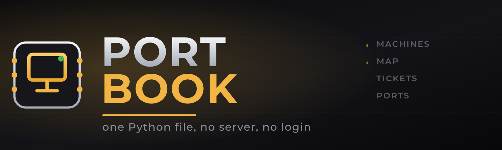
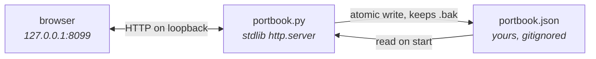
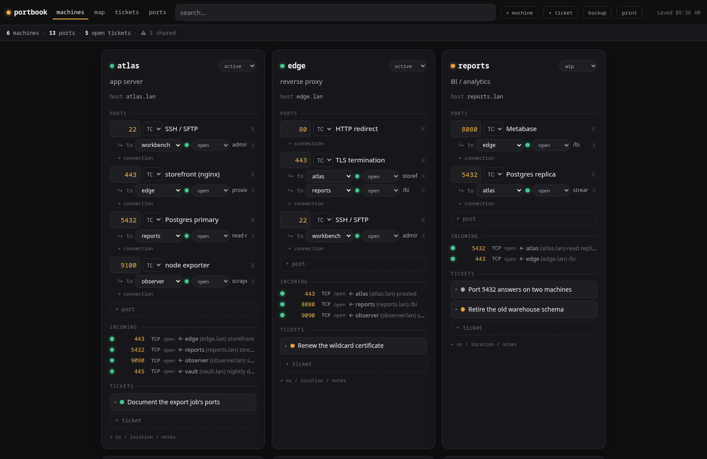
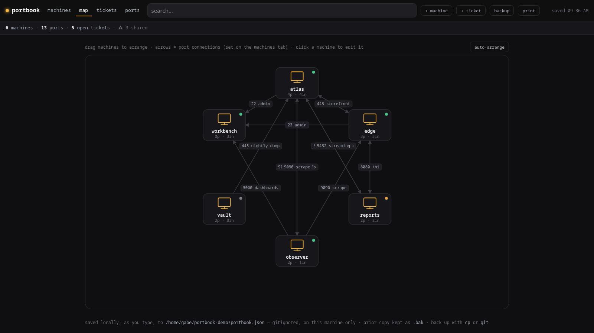
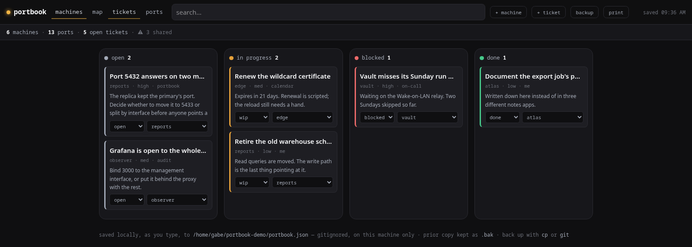
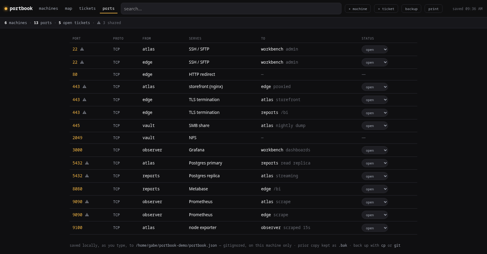

<div align="center">
  

  <br/>

  
  
  
  
  
</div>

## Introduction

**portbook** is a local tracker for a small fleet of machines: what each one
does, the **ports** it serves, **what connects to what**, and the **tickets**
open against it. It is one Python file. You run it, a small visual UI opens on
`127.0.0.1`, and everything you type saves to a JSON file sitting next to the
script.

It exists because the tools for this problem start at NetBox and go up from
there: a database, a container stack, a reverse proxy, accounts, and a weekend
of setup before you can write down that port 5432 is taken on two boxes. At
around five machines that is the wrong amount of tool, and the alternative most
people fall back on (a note in three different apps) is how you end up pointing
a client at the wrong host.

So portbook keeps the whole thing in the standard library and a browser tab. No
server to deploy, no Docker, no database, no login, nothing running in the
background, and no network exposure unless you deliberately ask for it.



## Run it

```bash
python3 portbook.py
```

That is the whole install. No `pip`, no venv, no Docker, no root. It serves the
UI on **`http://127.0.0.1:8099`** (loopback only, never reachable from any
network), opens your browser, and saves to **`portbook.json`** next to the
script. `Ctrl+C` stops it.

Options: `--port 9000`, `--file /path/to/other.json`, `--host`, `--no-open`.
Handy alias: `alias portbook='python3 ~/path/to/portbook.py'`.

## The four views

### Machines

Cards you edit in place: name, hostname or IP, role, status, and optional
OS/location/notes. Ports go underneath, each with its protocol, what it serves,
and what it connects to (picked from your other machines, or "external"), with
an optional port or detail per connection.

Connections are entered once and show on both ends: the target machine grows an
**incoming** list pointing back at the source and its hostname. Common ports
suggest their own label as you type (22 → SSH/SFTP, 443 → HTTPS, 3306 → MySQL,
and so on), filled in if you leave the field blank.



### Map

The same data as a network diagram. Every machine is a draggable node, every
connection an arrow labelled with its port. Drag to arrange (the layout is
saved), **auto-arrange** to reset it, click a machine to jump back to its card.
Nothing here is drawn by hand: the arrows are the connections you already
entered on the machines tab.



### Tickets

A status board across all machines: open, in progress, blocked, done. Tickets
are mostly **references to external ones** (the ISP, the org that manages your
ports), so each carries a ref number, a link that turns the ref into a clickable
arrow, the org it came from, a priority, and notes.

Create a ticket on its own from the header and assign it to a machine whenever
you like, or leave it unassigned.



### Ports

Every port on every machine in one table, sorted by number, with what it serves
and where it goes. Any port serving on more than one machine is flagged, which
is the mistake this tool is really for.



Plus instant search across everything, a **print** view (a clean one-page fleet
sheet), and a **backup** button that downloads a dated JSON.

## Your data

`portbook.json` is the single source of truth: a local, gitignored, plain,
human-readable file you can hand-edit. Everything saves as you type.

- **Back up:** `cp portbook.json portbook.$(date +%F).json`, or commit it, or
  drop it in a synced folder.
- **Restore or move:** copy the file back and restart, or point `--file` at it.
- Every save is atomic and keeps the previous copy as `portbook.json.bak`, which
  is your one-step undo.
- Hand-edit it only while the server is stopped. The running UI owns the file.

## Password protection (optional)

By default portbook is loopback-only and there is nothing to log into. To
require a login (useful if you want to reach it across a LAN, VPN or tailnet):

```bash
cp .env.example .env        # set PORTBOOK_PASSWORD, then restart portbook
# or, without a file:
PORTBOOK_PASSWORD=secret python3 portbook.py
```

With a password set, every page and API call requires a login. The password
lives in `.env` (gitignored, never committed), a session cookie (HttpOnly,
SameSite=Strict) keeps you signed in, and a logout button appears in the header.

To reach portbook beyond this machine, bind to a network address:

```bash
PORTBOOK_PASSWORD=secret python3 portbook.py --host 0.0.0.0
```

Traffic is plain HTTP, so only do this on a network you trust, never the open
internet. portbook prints a warning at startup if you bind to a network
interface with no password set.

## Restyle it (optional)

The UI is styled with **Tailwind, compiled to plain CSS and inlined** into
`portbook.py`, which is how it stays one self-contained file with no runtime
dependencies. To change the look:

```bash
# edit the tokens and components in build/input.css, then:
bash build/rebuild.sh
```

That recompiles the CSS and regenerates the `<style>` block inside
`portbook.py`. It needs the internet once to fetch the Tailwind standalone
binary (no Node required). Running the app never needs the build step.

## What it deliberately is not

No server, no Docker, no database, no nginx, no SSO, no network scanning, no
background service, no sync, no telemetry. Python standard library plus a
browser at runtime. If your fleet outgrows that, you have outgrown portbook, and
that is the point at which NetBox starts being worth its setup.
